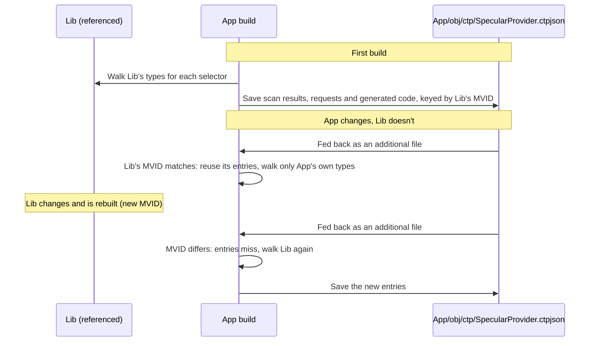

# Cross-Assembly Caching

# Cross-Assembly Caching

## The problem

A project's selectors usually reach into referenced assemblies: `FromAssemblies()`, `DependenciesFromAssemblyOf<T>()` and the
like walk every type of every matching reference. Referenced assemblies rarely change between builds of the project that
uses them, so walking them again on every build is wasted work, and in a large solution it is most of the generator's time.

## What Specular caches

Specular keeps one cache file per project, `obj/ctp/SpecularProvider.ctpjson`, and stores in it what it learned about each
**referenced** assembly on the last build. The project's own types are never cached: they are what you are editing.

The file is written and read by the [`Specular.Scanning`](../../guide/scanning-from-your-generator/) library that Specular's
generator is built on, under the consumer id `SpecularProvider`. It holds three kinds of entry, each stored per referenced
assembly:

| Entry           | What it holds                                                                                                                                                                                                                                                                                        |
| --------------- | ---------------------------------------------------------------------------------------------------------------------------------------------------------------------------------------------------------------------------------------------------------------------------------------------------- |
| Scan results    | For each selector's assembly and type filters, the types they matched in the assembly. Keyed by the request's [cache key](../scan-cache-file/#shape).                                                                                                                                                |
| `requests`      | The selectors a referenced assembly carries for its consumers: Specular records each library's own `GetTypes` and `Scan` calls on the library as `[assembly: AssemblyMetadata]`, and re-runs them against the consuming project. Decoding those attributes is cached here, even when there are none. |
| `sources/<key>` | The code a call site generated for the assembly. The key hashes the whole call-site location, the request it resolved to, and whether the build targets Native AOT, so two identical call sites in different projects never share an entry.                                                          |

Generated code that reported diagnostics is never cached, so diagnostics always come from a fresh run.

The file's layout is described in [The scan cache file](../scan-cache-file/).

## When an entry is used

Every entry is tied to the referenced assembly's **module version id (MVID)**, which the compiler changes whenever the
assembly's contents change. An entry is used only while the MVID it was stored with matches the reference's current one:

- A referenced assembly that was rebuilt with any change gets a new MVID, so all of its entries miss and it is walked again.
- A reference without a readable MVID is never cached. In the IDE, project references are live compilations rather than
  built files, so they are always walked; while you type, results are reused in memory for as long as the reference is
  unchanged instead.
- A cache file written by an older version of the format is ignored and rebuilt.
- Only entries used in a build are written back, so entries for removed references and selectors drop out.

The file is written only when its content changes, so an unchanged cache doesn't touch the project's up-to-date check.

## How the file gets back to the compiler

`Specular.targets` imports `Specular.Scanning.Cache.targets`, which, just before `CoreCompile`, adds every existing
`obj/ctp/*.ctpjson` to the compilation as an additional file, and deletes them on `Clean`. The generator finds its own file
by name. Nothing needs configuring.

## Two-project example

## Failure modes

| Situation                                                           | Behaviour                                                                     |
| ------------------------------------------------------------------- | ----------------------------------------------------------------------------- |
| The file is missing, empty, corrupt, or from another format version | Treated as empty: every referenced assembly is walked and the file rewritten. |
| A referenced assembly changed since the entry was written           | Its entries miss and it is walked again.                                      |
| The file can't be written (read-only `obj/`, IO error)              | Ignored; the build succeeds and the next build walks again.                   |
| The build runs outside MSBuild (no `IntermediateOutputPath`)        | Nothing is written.                                                           |

In every case the build produces the same output as an uncached build: the cache only saves work.

## `SpecularHashAttribute`

Specular still stamps each assembly it generates for with `[assembly: SpecularHashAttribute("…")]`, a hash of the generated
provider. It is no longer used to validate the cache, which relies on MVIDs.